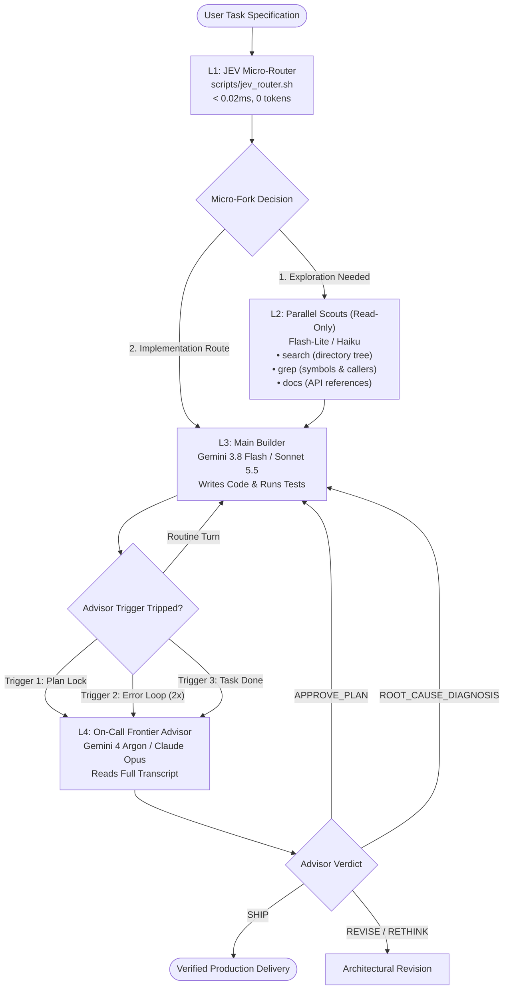

# Gemini Advisor & JEV Engineering

[](plugin.json)
[](LICENSE)
[](scripts/jev_router.py)
[](skills/gemini-advisor/references/token_optimization.md)
[](scripts/verify.sh)

> **Multi-tier capability routing with sub-millisecond JEV micro-routing for Google Antigravity and Claude Code.**  
> *Opus- and Argon-level judgment on every big call, without paying Frontier rates for every routine turn.*

---

## Table of Contents
1. [Overview](#overview)
2. [The 4-Tier Cognitive Hierarchy](#the-4-tier-cognitive-hierarchy)
3. [The Three Golden Advisor Triggers](#the-three-golden-advisor-triggers)
4. [JEV Engineering & Micro-Routing](#jev-engineering--micro-routing)
5. [Cross-Platform Execution (Antigravity & Claude Code)](#cross-platform-execution-antigravity--claude-code)
6. [Interactive Walkthrough: Step-by-Step](#interactive-walkthrough-step-by-step)
7. [Token Economics & ROI Analysis](#token-economics--roi-analysis)
8. [Dynamic Model Auto-Allocation](#dynamic-model-auto-allocation)
9. [Quick Start & Installation](#quick-start--installation)
10. [Verification & Test Suite](#verification--test-suite)
11. [Repository Structure](#repository-structure)
12. [License & Acknowledgements](#license--acknowledgements)

---

## Overview

Monolithic AI coding agents rely on a single large model for every phase of development. While simple, this architecture suffers from two critical bottlenecks:

1. **Token Inefficiency & Cost Leaks**: Top-tier Frontier reasoning models (Gemini 4 Argon, Claude Opus) burn premium tokens ingesting massive compiler logs, generating repetitive boilerplate code, and re-reading multi-turn chat histories.
2. **Confirmation Bias & Hallucination Loops**: A model auditing code it just wrote suffers from severe blind spots, repeatedly attempting the same failing pattern when bugs arise.

**Gemini Advisor** solves these challenges by organizing development into an autonomous, 4-tier capability hierarchy:
- Deterministic micro-forks (tool selection, path selection, 2x error detection) resolve in **microseconds with zero tokens** via JEV.
- Deep exploratory mapping runs across **three concurrent, ultra-low-cost read-only scouts** (search, grep, docs).
- Code implementation and test loops execute on **high-velocity builders** (Flash 3.8 / Sonnet 5.5).
- Apex Frontier judgment (Gemini 4 Argon / Claude Opus 5.5) stays **on-call** strictly for the three critical moments that determine software success.

---

## The 4-Tier Cognitive Hierarchy

```
┌────────────────────────────────────────────────────────────────────────────────────────┐
│                               THE 4-TIER COGNITIVE HIERARCHY                           │
├──────────────┬─────────────────────────┬──────────────┬───────────────┬────────────────┤
│ Tier / Role  │ Model (Antigravity)     │ Model (Claude)│ Latency / Cost│ Core Duty      │
├──────────────┼─────────────────────────┼──────────────┼───────────────┼────────────────┤
│ L1 Micro-Fork│ JEV Router (Python std) │ JEV Router   │ 0.010 ms / $0 │ Deterministic  │
│ L2 Scouts    │ Flash-Lite 3.1 (Scouts) │ Haiku 5.5    │ 300 ms / ~0.03¢│ Search, Grep,  │
│ L3 Builder   │ Flash 3.8 (Builder)     │ Sonnet 5.5   │ 1.5 s  / ~0.07¢│ Code execution │
│ L4 Advisor   │ Gemini 4 Argon (Apex)   │ Opus 5.5     │ On-Call Only  │ The 3 Triggers │
└──────────────┴─────────────────────────┴──────────────┴───────────────┴────────────────┘
```



---

## The Three Golden Advisor Triggers

Instead of paying Frontier rates for routine turns, the Frontier Advisor is summoned strictly at **Three Golden Moments**:

```text
1. BEFORE A PLAN LOCKS (plan_lock)
   • When: Architecture or 5-part contract has been drafted; before any code edits begin.
   • Why: Catching a flawed design at minute 1 costs 1,000 tokens. Catching it after 500 lines of code costs 50,000 tokens.
   • Output: APPROVE_PLAN or REVISE_PLAN with edge-case corrections.

2. WHEN THE SAME ERROR SHOWS UP TWICE (error_loop)
   • When: JEV detects an identical normalized error hash twice in succession.
   • Why: Builders retry typos easily, but 2x failures indicate an assumption trap / hallucination loop.
   • Action: HALT BUILDER IMMEDIATELY. Advisor diagnoses root cause to break the loop.

3. BEFORE CALLING IT DONE (task_done)
   • When: Implementation is finished, and local verification tests report passing exit codes.
   • Why: Eliminate builder confirmation bias and verify no subtle regressions exist.
   • Output: SHIP (approved), FIX-FIRST (blocking issues identified), or RETHINK.
```

See [skills/gemini-advisor/references/advisor_triggers.md](skills/gemini-advisor/references/advisor_triggers.md) for trigger protocols and payloads.

---

## JEV Engineering & Micro-Routing

**JEV (Joint Evaluation & Value)** is a high-speed, zero-token "System One" decision engine. Micro-forks that need no deep creative thinker go to JEV in milliseconds:

```bash
# 1. Evaluate delivery route mode (solo, delegate, audit, full)
bash scripts/jev_router.sh --route --task "Add rate limiter middleware" --files app.py

# 2. Select optimal tool signature deterministically
bash scripts/jev_router.sh --tool-choice --task "Find all call sites of resolve_allocation"

# 3. Fast path ranking from project structure
bash scripts/jev_router.sh --select-path --task "model allocator python tests"

# 4. Error loop detection (trips Advisor Trigger 2 on 2nd repeat)
bash scripts/jev_router.sh --check-error --error "AssertionError: expected 200 got 500 at line 42"

# 5. Check advisor trigger status
bash scripts/jev_router.sh --advisor-trigger --stage plan_lock

# 6. Benchmark micro-routing latency
bash scripts/jev_router.sh --benchmark
```

### Measured JEV Latency SLA
Benchmarked over 1,000 continuous micro-decisions:
- **Average Decision Latency**: **0.010 ms (10 microseconds)**
- **P50 Latency**: **0.009 ms**
- **P95 Latency**: **0.011 ms**
- **P99 Latency**: **0.021 ms**
- **Token Spend**: **0 tokens**

See [skills/gemini-advisor/references/jev_engineering.md](skills/gemini-advisor/references/jev_engineering.md).

---

## Cross-Platform Execution (Antigravity & Claude Code)

Gemini Advisor runs seamlessly across both Google Antigravity and Claude Code:

### 1. Google Antigravity
Dynamic Frontier-to-Execution routing with Gemini:
- **Main Driver / Builder**: Gemini 3.8 Flash (or Gemini 4 Argon for solo)
- **Parallel Scouts**: `gemini_advisor_search`, `gemini_advisor_grep`, `gemini_advisor_docs` (`flash_lite`)
- **Advisor**: `gemini_advisor_advisor` (`inherit` / `pro`)
- **Micro-Router**: `scripts/jev_router.sh`
- **Rule file**: [`rules/AGENTS.md`](rules/AGENTS.md) and [`rules/GEMINI.md`](rules/GEMINI.md)

### 2. Claude Code
Launch Claude Code using Anthropic's advisor flag:
```bash
claude --model sonnet --advisor opus
```
- **Driver**: Sonnet 5.5 (runs session, writes code)
- **Scouts**: Haiku 5.5 subagents (`search`, `grep`, `docs`)
- **Advisor**: Opus 5.5 (summoned at the 3 Golden Triggers)
- **Micro-Router**: JEV routes fast deterministic forks in milliseconds
- **Rule file**: [`rules/CLAUDE.md`](rules/CLAUDE.md)

---

## Interactive Walkthrough: Step-by-Step

### 1. Triggering Gemini Advisor
Include the trigger phrase in your user prompt:
```text
Use gemini-advisor to implement rate-limiting middleware in Express and verify it. Declare the selective route before task tools.
```

### 2. What Happens Behind the Scenes

#### Phase 1: Pre-Flight JEV Check & Route Declaration
JEV evaluates the blast radius and emits the machine-auditable declaration:
```text
SELECTIVE ROUTE
mode: full
risk: Rate-limiting middleware affects public routes; requires unit tests and independent review.
allocation: Planner (Gemini 4 Argon [Frontier]) -> Builder (Gemini 3.8 Flash [flash]) -> Reviewer (Fresh Gemini 4 Argon [inherit])
```

#### Phase 2: Parallel Scout Exploration
Lightweight subagents map the repo concurrently at ~0.03¢ per million tokens:
- `search`: Discovers `src/middleware/` and `src/server.ts`.
- `grep`: Finds all existing middleware registrations and Express app listeners.
- `docs`: Pulls up-to-date Express and Redis rate-limiting options.

#### Phase 3: Trigger 1 (Plan Lock)
Before writing code, the Architect formats the 5-part contract and consults the Frontier Advisor:
- Advisor reviews file boundaries, edge-case coverage, and safety constraints.
- Advisor grants `APPROVE_PLAN`.

#### Phase 4: Delegated Code Construction (Flash 3.8 / Sonnet 5.5)
The Builder writes the implementation and tests under strict file boundaries, outputting an `IMPLEMENTATION REPORT`.

#### Phase 5: Trigger 2 Guard (Loop Breaker)
If a test fails with the same error twice, JEV trips **Advisor Trigger 2**. The Builder immediately halts, and the Frontier Advisor provides the exact root-cause fix.

#### Phase 6: Trigger 3 (Task Done Audit)
When tests pass, `gemini_advisor_reviewer` audits the accumulated git diff in an isolated, read-only context and grants `VERDICT: SHIP`.

---

## Token Economics & ROI Analysis

By delegating verbose code generation to Flash and isolating the review to a fresh context, Gemini Advisor dramatically reduces total spend:

| Phase | Monolithic Approach (All Frontier Argon/Opus) | Gemini Advisor 4-Tier Hierarchy | Net Impact |
| :--- | :--- | :--- | :--- |
| **Micro-Routing** | 10,000 Frontier tokens ($0.05) | **0 tokens via JEV** ($0.000) | **100% Free** |
| **Exploration** | 25,000 Frontier tokens ($0.12) | 25,000 **Flash-Lite / Haiku** ($0.001) | **~99% Savings** |
| **Planning & Triggers**| 6,000 Frontier tokens ($0.03) | 6,000 **Frontier tokens** ($0.030) | Maintained Quality |
| **Implementation** | 50,000 Frontier tokens ($0.25) | 50,000 **Flash 3.8 / Sonnet** ($0.015) | **~94% Savings** |
| **Diff Audit** | 60,000 Frontier tokens ($0.30) | 6,000 **Fresh Frontier diff** ($0.030) | **~90% Savings** |
| **Total Spend** | **$0.75 per feature** | **$0.076 per feature** | **~89% Lower Cost** |

### Integrated Token Counter CLI
Calibrated for Gemini's 256k vocabulary:
```bash
# Compare Monolithic vs Triad ROI on standard tasks
bash scripts/token_counter.sh --compare

# Count tokens in the active git diff before review
bash scripts/token_counter.sh --diff

# Measure tokens in an Antigravity conversation transcript
bash scripts/token_counter.sh --transcript ~/.gemini/antigravity/transcript.jsonl
```

---

## Dynamic Model Auto-Allocation

Gemini Advisor includes an automated discovery engine (`scripts/model_allocator.sh`):
- Discovers models across Antigravity transcripts, environment variables, and the Gemini API.
- Automatically ranks future models (Gemini 5+, Opus releases) without requiring package updates.
- Preserves apex reasoning during subagent spawns via `Model: "inherit"`.

```bash
# Check active model tiers
bash scripts/model_allocator.sh --check

# Generate dynamic SELECTIVE ROUTE allocation line
bash scripts/model_allocator.sh --allocate

# Run allocator self-tests
bash scripts/model_allocator.sh --test
```

---

## Quick Start & Installation

### Option 1: Global Installation *(Recommended)*
```bash
# Clone and run global installer
git clone https://github.com/Norbert-Brett/gemini-advisor.git ~/.gemini-advisor
bash ~/.gemini-advisor/scripts/install.sh --global

# Verify installation
bash ~/.gemini-advisor/scripts/install.sh --check
```

### Option 2: Project-Local Installation *(For Teams)*
```bash
cd /path/to/your/project
mkdir -p .agents/plugins
git clone https://github.com/Norbert-Brett/gemini-advisor.git .agents/plugins/gemini-advisor
```

---

## Verification & Test Suite

Run the full automated test suite verifying JSON manifests, YAML frontmatter, reference docs, shell syntax, model allocator invariants, JEV micro-router latency SLA, and token counter accuracy:

```bash
bash scripts/verify.sh
```

```text
==> Verifying Gemini Advisor Plugin at: /Users/br3tt/Desktop/projects/gemini-advisor
1. Checking JSON manifests...               ✓ Valid JSON
2. Checking skills and frontmatter...       ✓ Valid frontmatter
3. Checking documentation references...     ✓ 11/11 references exist
4. Checking shell scripts syntax...         ✓ 6/6 scripts syntax clean
5. Running model allocator tests...         ✓ 9/9 self-tests passed & invariants checked
6. Running JEV micro-router tests...        ✓ 10/10 tests passed & latency benchmark (<0.02ms)
7. Running token counter tests...           ✓ 8/8 self-tests passed

==> ALL CHECKS PASSED! Gemini Advisor plugin is healthy.
```

---

## Repository Structure

```text
.
├── plugin.json                              # Antigravity plugin manifest (v0.3.0)
├── plugins/
│   └── gemini-advisor/
│       └── plugin.json                      # Discovery manifest
├── config/
│   └── model_tiers.json                     # Model tier registry & JEV config
├── rules/
│   ├── AGENTS.md                            # Antigravity 4-tier rules & JEV checks
│   ├── GEMINI.md                            # Gemini compatibility alias
│   └── CLAUDE.md                            # Claude Code advisor & JEV rules
├── skills/
│   └── gemini-advisor/
│       ├── SKILL.md                         # Core orchestration & JEV skill
│       └── references/
│           ├── advisor_triggers.md          # The Three Golden Advisor Triggers
│           ├── jev_engineering.md           # JEV System One micro-routing & benchmarks
│           ├── role_contracts.md            # Role definitions and prompt templates
│           ├── routing_matrix.md            # Risk evaluation decision matrix
│           ├── review_protocol.md           # 4-pillar audit rubric & verdicts
│           └── token_optimization.md        # Token saving strategies & benchmarks
├── scripts/
│   ├── jev_router.py                        # JEV System One micro-routing engine
│   ├── jev_router.sh                        # CLI wrapper for JEV router
│   ├── model_allocator.py                   # Dynamic model discovery & scoring engine
│   ├── model_allocator.sh                   # CLI wrapper for model allocator
│   ├── token_counter.py                     # Real token counter & economic estimator
│   ├── token_counter.sh                     # Shell CLI wrapper for token counter
│   ├── install.sh                           # Idempotent plugin installer
│   ├── verify.sh                            # Test & validation suite
│   └── diff_summary.sh                      # Unified diff extractor for reviews
├── LICENSE                                  # MIT License
└── README.md                                # Project documentation
```

---

## License & Acknowledgements

This project is licensed under the MIT License.

The selective routing architecture is inspired by the multi-tier orchestration methodologies of [sol-advisor](https://github.com/DannyMac180/sol-advisor) and Anthropic's Claude Code multi-model advisor architecture.
