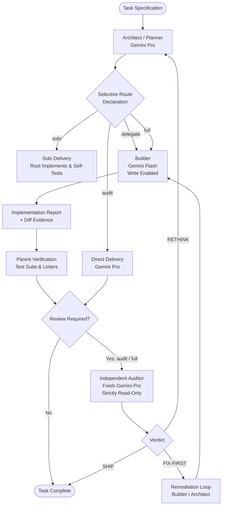

# Gemini Advisor

Multi-model capability routing and selective task orchestration for Google Antigravity.

---

## Overview

Modern agentic engineering workflows often rely on a single monolithic model for all phases of a task. While effective, this approach introduces two systemic inefficiencies:

1. **Token Inefficiency**: High-reasoning models spend costly tokens ingesting verbose compiler outputs, generating boilerplate code, and re-reading large conversation histories.
2. **Confirmation Bias**: An agent that generates code inherently struggles to audit its own work objectively, frequently missing regressions and subtle edge cases.

**Gemini Advisor** solves these challenges by implementing a capability-routed architecture:
- **Gemini Pro**: High-level intent, architectural decomposition, and contract drafting.
- **Gemini Flash / Flash-Lite**: Fast, bounded code implementation at **10–20x lower token cost**.
- **Fresh Gemini Pro (Read-Only)**: Zero-bias audit evaluating only the final diff and verification logs in an isolated context.



---

## Quick Start & Installation

You can install Gemini Advisor globally for all your projects or locally within a specific repository.

### Option 1: Global Installation *(Recommended)*

Installs Gemini Advisor once so it is automatically active across all Antigravity workspaces:

```bash
# 1. Clone the repository to your home directory
git clone https://github.com/Norbert-Brett/gemini-advisor.git ~/.gemini-advisor

# 2. Run the global installer
bash ~/.gemini-advisor/scripts/install.sh --global

# 3. Verify the installation
bash ~/.gemini-advisor/scripts/install.sh --check
```

### Option 2: Project-Local Installation *(For Teams)*

Installs Gemini Advisor directly inside a project's `.agents/` folder so it can be shared with team members:

```bash
# Navigate to your project root
cd /path/to/your/project

# Clone directly into the project's plugins directory
mkdir -p .agents/plugins
git clone https://github.com/Norbert-Brett/gemini-advisor.git .agents/plugins/gemini-advisor
```

Antigravity automatically discovers plugins in `.agents/plugins/` when opening the project.

---

## How to Use: Step-by-Step

Once installed, Gemini Advisor integrates seamlessly into the Antigravity IDE, Desktop App, and CLI (`agy`).

### 1. Triggering Gemini Advisor

Simply include the trigger phrase in your prompt:

```text
Use gemini-advisor to build [feature description] and verify it. Declare the selective route before task tools.
```

#### Example Prompts:
- **Feature Addition**:  
  `"Use gemini-advisor to implement a rate-limiting middleware in Express and add integration tests. Declare the selective route before task tools."`
- **Refactoring**:  
  `"Use gemini-advisor to refactor the database query layer to use Prisma transactions. Declare the selective route before task tools."`
- **Bug Fix**:  
  `"Use gemini-advisor to investigate and resolve the race condition in the auth token refresh loop. Declare the selective route before task tools."`

---

### 2. What Happens Behind the Scenes

When you run a prompt with Gemini Advisor, the agent executes a structured 4-phase lifecycle:

#### Phase 1: Upfront Route Declaration
Before modifying any files, the Architect evaluates the task's blast radius and emits a machine-auditable declaration in chat:
```text
SELECTIVE ROUTE
mode: full
risk: Rate-limiting middleware affects all incoming API traffic; requires unit tests and independent review.
allocation: Planner (Pro) -> Builder (Flash) -> Reviewer (Fresh Pro)
```

#### Phase 2: Delegated Code Construction (Flash)
If the route is `delegate` or `full`, the Architect defines an unambiguous 5-part contract (Objective, Files & Ownership, Interfaces, Constraints, Verification) and invokes `gemini_advisor_builder` using **Gemini Flash**.
- The Builder writes code, creates files, and runs initial unit tests.
- Because Flash is used for implementation, high-volume code generation occurs at **~90% lower cost**.
- The Builder returns an `IMPLEMENTATION REPORT` summarizing changes made and test outputs.

#### Phase 3: Parent Verification
The primary Architect (Gemini Pro) reviews the diff and independently reruns the verification suite (e.g., `npm test` or `pytest`) to confirm all tests pass cleanly.

#### Phase 4: Independent Read-Only Review (Fresh Pro)
If the route is `audit` or `full`, the Architect spawns `gemini_advisor_reviewer` using a **fresh context** of Gemini Pro with `enable_write_tools: false`.
- The Reviewer receives **only** the objective, the git diff, and the test logs.
- Because it has no historical conversation baggage and cannot edit files, it performs a strict, zero-bias audit.
- The Reviewer issues a structured verdict:
  - **`SHIP`**: Changes meet all standards. The task completes.
  - **`FIX-FIRST`**: Concrete bugs or missing tests identified. The Architect feeds fixes back to the Builder and re-reviews.
  - **`RETHINK`**: Architectural inconsistency. The Architect halts and redesigns the approach.

---

## Selective Routing Modes

To prevent unnecessary orchestration overhead, Gemini Advisor defaults to `solo` for simple tasks and only scales up to auxiliaries when task risk demands it:

| Mode | Flow | Auxiliaries | When to Use |
| :--- | :--- | :---: | :--- |
| **`solo`** *(Default)* | Architect plans, builds, and self-verifies | 0 | Typos, documentation, isolated one-file bug fixes, and minor script tweaks. |
| **`delegate`** | Pro plans -> Flash builds -> Pro verifies | 1 | Well-specified features, boilerplate endpoints, migrations, and bounded refactors. |
| **`audit`** | Pro plans & builds -> Fresh Pro audits | 1 | High-risk code written directly by Pro (auth, cryptography, schema migrations). |
| **`full`** | Pro plans -> Flash builds -> Pro tests -> Fresh Pro audits | 2 | Substantial multi-module features and critical production paths. |

> **Escalation Guarantee**: A route may escalate to higher scrutiny if unexpected complexity is discovered during execution, but it will **never silently downgrade**.

---

## Token Economics & Verification Tooling

By delegating verbose code generation to Flash and isolating the review to a fresh context, Gemini Advisor dramatically reduces total spend:

| Phase | Monolithic Approach (All-Pro) | Gemini Advisor Triad | Net Impact |
| :--- | :--- | :--- | :--- |
| **Planning** | 4,000 Pro tokens | 4,000 Pro tokens | Neutral |
| **Implementation** | 40,000 Pro tokens | 40,000 **Flash** tokens | ~90% Cost Reduction |
| **Build & Test Output** | 30,000 Pro tokens | 30,000 **Flash** tokens | ~90% Cost Reduction |
| **Independent Audit** | 50,000 Pro tokens (accumulated context) | 5,000 **Fresh Pro** tokens (isolated diff) | ~90% Context Reduction |
| **Effective Total** | **124,000 Pro tokens** | **9,000 Pro + 70,000 Flash tokens** | **~75–85% Lower Cost** |

### Integrated Token Counter CLI

Gemini Advisor includes an integrated tokenizer and cost estimator (`scripts/token_counter.sh`) calibrated for Gemini's 256k vocabulary:

```bash
# Run automated verification self-tests
bash ~/.gemini-advisor/scripts/token_counter.sh --test

# Compare Monolithic vs Triad ROI on standard tasks
bash ~/.gemini-advisor/scripts/token_counter.sh --compare

# Measure token count of a file or directory
bash ~/.gemini-advisor/scripts/token_counter.sh --file path/to/file.ts
bash ~/.gemini-advisor/scripts/token_counter.sh --dir src/

# Count tokens in the active git diff before review
bash ~/.gemini-advisor/scripts/token_counter.sh --diff

# Measure tokens in an Antigravity conversation transcript
bash ~/.gemini-advisor/scripts/token_counter.sh --transcript ~/.gemini/antigravity/transcript.jsonl

# Measure tokens from piped text
echo "const apiKey = process.env.API_KEY;" | bash ~/.gemini-advisor/scripts/token_counter.sh
```

---

## Maintenance & Updating

### Updating to the Latest Release
```bash
cd ~/.gemini-advisor
git pull origin main
bash scripts/install.sh --check
```

### Running the Test Suite
Ensure all manifests, reference documentation, shell scripts, and tokenizer tests pass:
```bash
bash ~/.gemini-advisor/scripts/verify.sh
```

### Uninstalling
```bash
rm -f ~/.gemini/config/plugins/gemini-advisor
rm -rf ~/.gemini-advisor
```

---

## Repository Structure

```text
.
├── plugin.json                              # Antigravity plugin manifest
├── plugins/
│   └── gemini-advisor/
│       └── plugin.json                      # Nested discovery manifest
├── rules/
│   ├── AGENTS.md                            # Active rules enforcing route declarations & roles
│   └── GEMINI.md                            # Compatibility alias
├── skills/
│   └── gemini-advisor/
│       ├── SKILL.md                         # Core Antigravity orchestration skill
│       └── references/
│           ├── role_contracts.md            # Role definitions and prompt templates
│           ├── routing_matrix.md            # Risk evaluation decision matrix
│           ├── review_protocol.md           # 4-pillar audit rubric & verdicts
│           └── token_optimization.md        # Token saving strategies & benchmarks
├── scripts/
│   ├── token_counter.py                     # Real token counter & economic estimator
│   ├── token_counter.sh                     # Shell CLI wrapper for token counter
│   ├── install.sh                           # Idempotent plugin installer
│   ├── verify.sh                            # Test & validation suite
│   └── diff_summary.sh                      # Unified diff extractor for reviews
├── LICENSE                                  # MIT License
└── README.md                                # Project documentation
```

---

## License & Acknowledgements

This project is licensed under the MIT License.

The selective routing architecture is inspired by the orchestration methodology of [sol-advisor](https://github.com/DannyMac180/sol-advisor).
