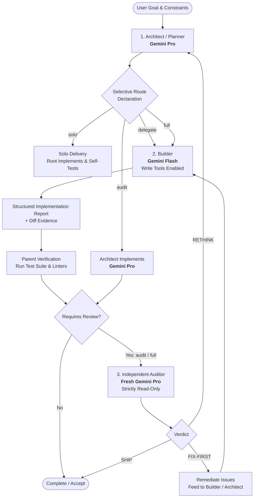

# Gemini Advisor 🛡️⚡

> **Capability-routed, multi-model software delivery for Google Antigravity and Gemini.**  
> *Plan with Pro. Build with Flash. Audit with Fresh Pro. Burn up to 80% fewer tokens.*

Inspired by [`DannyMac180/sol-advisor`](https://github.com/DannyMac180/sol-advisor.git), **Gemini Advisor** is an Antigravity plugin that organizes software engineering tasks across specialized model tiers. Instead of running a single monolithic model that burns costly tokens on repetitive tasks and suffers from confirmation bias, Gemini Advisor routes each phase to its optimal counterpart.

---

## The Model Triad



1. **Architect / Planner (`pro`)**:
   - Understands intent, reviews repository structure, and issues the mandatory upfront `SELECTIVE ROUTE` declaration.
   - Decomposes work into modular milestones with strict file ownership boundaries and crisp 5-part specifications.
2. **Builder / Implementer (`flash` or `flash_lite`)**:
   - Executes routine coding, refactoring, and file edits at **10-20x lower cost** and lightning speed.
   - Constrained to owned files, preserving existing code styles and running local verification commands.
3. **Reviewer / Auditor (Fresh `pro` in read-only mode)**:
   - Spawns in an **isolated context** with zero confirmation bias.
   - Has `enable_write_tools: false` to guarantee it cannot make untested modifications.
   - Evaluates the accumulated unified diff and test outputs, issuing a decisive verdict: `SHIP`, `FIX-FIRST`, or `RETHINK`.

---

## Selective Routing Modes

| Mode | Flow | Auxiliary Spawns | Best For |
| :--- | :--- | :--- | :--- |
| **`solo`** *(Default)* | Root plans, builds, and self-verifies | None (0) | Typo fixes, simple scripts, single-file adjustments, docs |
| **`delegate`** | Pro plans -> Flash builds -> Pro tests | 1 (`gemini_advisor_builder`) | Well-specified features, boilerplate endpoints, refactors |
| **`audit`** | Pro plans & builds -> Fresh Pro audits | 1 (`gemini_advisor_reviewer`) | Security-sensitive auth, cryptography, schema migrations |
| **`full`** | Pro plans -> Flash builds -> Pro tests -> Fresh Pro audits | 2 sequentially | Substantial features, cross-cutting multi-module changes |

---

## Token Economy: Why It Matters

In standard agent sessions, thousands of tokens are wasted re-ingesting conversation backlogs, analyzing verbose compiler outputs, and generating routine boilerplate with top-tier models.

| Step | Monolithic Pro Approach | Gemini Advisor Triad | Net Savings |
| :--- | :--- | :--- | :--- |
| **Planning** | ~4,000 Pro tokens | ~4,000 Pro tokens | Neutral |
| **Implementation** | ~40,000 Pro tokens | ~40,000 **Flash** tokens | **~90% Cost Reduction** |
| **Terminal & Build Loops** | ~30,000 Pro tokens | ~30,000 **Flash** tokens | **~90% Cost Reduction** |
| **Independent Review** | ~50,000 Pro tokens (bloated history) | ~5,000 **Fresh Pro** tokens (isolated diff) | **~90% Context Reduction** |
| **Total Impact** | **124,000 Pro tokens** | **9k Pro + 70k Flash** | **~75-80% Lower Total Spend** |

---

## Quick Start

### 1. Installation

You can link or install Gemini Advisor globally (`~/.gemini/config/plugins/`) or within your current workspace (`.agents/plugins/`):

```bash
# Global installation (recommended across all workspaces)
bash scripts/install.sh --global

# Workspace-local installation
bash scripts/install.sh --workspace

# Verify installation health
bash scripts/install.sh --check
```

### 2. Using in Antigravity Chat or CLI (`agy`)

Simply prompt Antigravity:

```text
Use gemini-advisor to implement the user authentication module and verify it. Declare the selective route before task tools.
```

The Architect will emit the selective route declaration:
```text
SELECTIVE ROUTE
mode: full
risk: User authentication handles password hashing, JWT tokens, and DB sessions.
allocation: Planner (Pro) -> Builder (Flash) -> Reviewer (Fresh Pro)
```

### 3. Measuring Real Tokens & Cost Savings

Gemini Advisor includes a real token counter and economic estimator calibrated for Gemini's 256k vocabulary:

```bash
# Run automated token counter self-tests
bash scripts/token_counter.sh --test

# Compare Monolithic Pro vs Gemini Advisor Triad cost & token savings
bash scripts/token_counter.sh --compare

# Count tokens in a file or directory
bash scripts/token_counter.sh --file skills/gemini-advisor/SKILL.md
bash scripts/token_counter.sh --dir skills/

# Count tokens in an active git diff
bash scripts/token_counter.sh --diff

# Measure real token usage in an Antigravity transcript
bash scripts/token_counter.sh --transcript path/to/transcript.jsonl

# Count tokens from piped text
echo "function hello() { return 'world'; }" | bash scripts/token_counter.sh
```

---

## Repository Structure

```text
.
├── plugin.json                              # Root Antigravity plugin manifest
├── plugins/
│   └── gemini-advisor/
│       └── plugin.json                      # Nested plugin manifest for standard discovery
├── rules/
│   ├── AGENTS.md                            # Active rules enforcing route declarations & roles
│   └── GEMINI.md                            # Compatibility alias
├── skills/
│   └── gemini-advisor/
│       ├── SKILL.md                         # Core Antigravity orchestration skill
│       └── references/
│           ├── role_contracts.md            # Exact prompt schemas for Builder & Reviewer
│           ├── routing_matrix.md            # Risk evaluation decision matrix
│           ├── review_protocol.md           # 4-pillar audit rubric & verdicts
│           └── token_optimization.md        # Token saving strategies & benchmarks
├── scripts/
│   ├── token_counter.py                     # Real token counter & pricing estimator
│   ├── token_counter.sh                     # Convenient shell wrapper for token counting
│   ├── install.sh                           # One-step installer (--global or --workspace)
│   ├── verify.sh                            # Plugin test & validation suite (includes self-tests)
│   └── diff_summary.sh                      # Token-efficient diff & status generator
├── LICENSE                                  # MIT License
└── README.md                                # This document
```

---

## License

MIT © Gemini Advisor Contributors. Inspired by the orchestration methodology of [sol-advisor](https://github.com/DannyMac180/sol-advisor).
